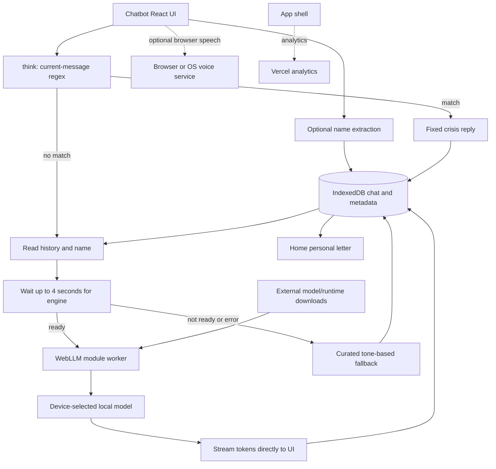

# Architecture audit — 5 November 2026

Reading context: this document records the initial audit and proposed controls. Later implementation and verification are recorded in [Milestone 2](milestone_2_report.md). Retaining the original findings makes the correction traceable; present-tense statements below describe the audited baseline unless a dated follow-up says otherwise. The audit and subsequent implementation were agent-assisted.

Status: initial source audit and local build checks, not a deployment certification. All paths below are relative to the supplied workspace unless stated otherwise. Findings are tracked in [known issues](known_issues.md).

## Provenance and preservation

The workspace contains **two independent repositories**, not one monorepo:

- Application: `relevia/`, clean tracked working tree on inspection, commit `d6d2ec2f8ccbeb69b0b992bb24b64af52fed68ce`.
- Research: `relevia-research/`, clean tracked working tree on inspection, commit `8c3cf54781a3c9552c46bd57e603b57a56a6aae3`.
- The outer workspace has an unborn Git HEAD. It must not be reported as the application source revision.
- GitHub metadata and the public default-branch commit were fetched on 5 November. `bushrakhandoker708/relevia` defaults to `main`, at the same application SHA. The root listing does not contain `relevia-research/`. The local app remote still uses the older `Bushraabir` address. No remotes or history were rewritten.
- The supplied ZIP contains 43,788 entries. Byte comparison confirmed that its `releviaBrain.js`, `db.js`, and research README match the extracted files. This is a spot check, not a claim of full archive equality.
- `scripts/audit_snapshot.py` records file checksums, data counts, overlap, notebook execution metadata and a limited redacted history screen. Existing datasets, archives, adapters directories and application source are preserved.

## Implemented architecture

`src/services/releviaBrain.js` dynamically imports WebLLM, requests a WebGPU adapter, chooses tiers using RAM/mobile/GPU/f16 hints and starts a module worker. It can fall back to main-thread inference if worker construction fails. Non-network load failures step down 3B → 1B → 0.5B. Network failures use a retry cooldown. An uncached standard device initially loads 1B and offers an upgrade. These are device heuristics, **not input-risk selective inference**.

`src/services/modelConfig.js` defines Llama-3.2-3B and 1B Instruct plus Qwen2.5-0.5B Instruct, q4f16/q4f32 variants, a 1,536-token runtime context and 110-token reply cap. `CUSTOM_MODEL = null`: no adapted model is enabled. Configured size labels are 1.8/0.7/0.3 GB; the README still gives 2.3/0.9 GB. Neither is a download measurement from this audit. Weight quantization and runtime arithmetic precision must be described separately.

`llmWorker.js` delegates messages to `WebWorkerMLCEngineHandler`. `think()` uses temperature 0.6, top-p 0.9 and frequency penalty 0.3. History is cropped using message IDs and a character budget, not a tokenizer. Warm-up uses a short hidden generation. Performance comments describing previous timings are historical author claims, not reproduced measurements.

`safety.js` returns a fixed response for a substring regex match. It does not inspect previous turns, model output, language or semantic context. `memoryUtils.js` uses the same regex and other keyword lists for fallback selection. Direct streaming has no output-safety gate. Generated and curated replies share a string-only return contract, so per-message provenance is unavailable.

`db.js` has one cached IndexedDB connection to database `relevia`, version 3, with `chat` and `meta` stores. The supplied UID is ignored. Chat writes prune rows older than 24 hours; reads do not filter expiry, and metadata has no expiry. Crisis turns are deliberately persisted. `clear()` exists but no chat UI calls it. `personalLetter.js` reads the same history/name and can expose a previous visitor's distress on the Home page; visit counters are in localStorage/sessionStorage.

`groqApi.js` is unused by the inspected application import path. It still contains a Vite-exposed key mechanism, cloud request code, separate persistent history and a fictitious human persona. A local `.env` exists and is not tracked at HEAD. Its contents are not reproduced here. The BFG report documents deletion of a large adapter, **not proof of credential removal or rotation**.

`Chatbot.jsx` sets user ID to `anon`, extracts and saves names, logs messages and response prefixes, streams replies, supports speech synthesis and imposes a 12-message limit. The opening describes a caring friend, and the footer assumes a US support number. A timer can begin model download after 20 seconds on selected connections. Connection speed hints do not establish that a connection is unmetered.

## Existing research assets

The local research repository already includes dataset building, QLoRA training, generation, automatic metrics, blinded rating-sheet creation, learning-rate sweeps, side-by-side inspection, export code and three notebooks (`colab_runner`, `02_results_analysis`, `train_for_app`). Preserve and improve these. The app README's notebook reference is unavailable in its public repository, but the notebook is **not nonexistent locally**.

Processed data are present. The recorded manifest reports 28,602 training pairs, 4,539 validation pairs, four few-shot pairs, 4,181 seen-test pairs and 839 unseen-test pairs. These do not authenticate the separate historical claim of approximately 45,000 examples. The safety fixtures are small starter sets. Results and current adapter directories contain placeholders, not completed experiment evidence. Archived work requires separate provenance review before reuse.

The implementation uses official ED splits and holds out six emotion labels. However, few-shot selection excludes only the selected row IDs from validation, not their entire conversations. Model revisions and Python dependency versions are not pinned. Primary human ratings currently use 0–2 empathy dimensions, which differs from the requested six 1–5 dimensions. Automatic referral-word matching is not a safety judgment.

## Verified versus unverified

| Check | Actual outcome | Interpretation |
|---|---|---|
| Public default branch and local app revision | Same SHA above | Source provenance established at inspection time |
| Existing-environment `npm run build` | Exit 0; chunk-size warning | Bundling works with installed dependencies |
| `npm run lint` | Exit 1; 44 errors, 11 warnings | Baseline fails; includes JSX-used imports flagged by configuration |
| 12 diagnostic regex probes | Four missed provisional high-risk cases, three false alarms; one ambiguous case unscored | Concrete counterexamples, not a representative safety estimate |
| Fresh dependency install | Not performed | Existing node_modules is not a clean reproducible environment |
| Browser model loading/latency, UI accessibility | Not exercised | No compatibility, speed or accessibility certification |
| Deployed site and network traffic | Not inspected live | Source architecture is not proof of production behavior |
| Training / exported-model parity | Not run | No learned-model quality or safety claims |

Node v22.17.1, npm 10.9.2 and Python 3.13.6 were observed. No GPU training environment is established. The build's compression log contains unusual absolute-path formatting; inspect served compressed assets before deployment. No deployment was performed.

Next: implement and test privacy boundaries and honest response provenance before expanding model experiments.

## Machine-readable audit follow-up

The audit script completed: locked WebLLM is 0.2.79; all nine inspected research Python files parse; all three notebooks have zero executed cells. It confirmed all four few-shot conversation groups overlap validation, while the other checked split pairs have zero conversation-ID overlap. This is not a near-duplicate or pretraining-contamination audit. Safety fixtures contain 12 crisis and 10 sycophancy rows.

The limited history screen inspected 176 app blobs and 40 research blobs under 2 MB, finding no matches for the selected token patterns. A matching token-shaped value exists in the untracked local .env. Values were not printed. Exposure, validity and rotation status remain unknown; a comprehensive scanner and generated-artifact review are still needed.
