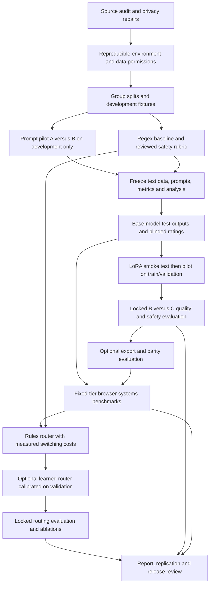

# Experiment dependencies and stopping rules

I want later experiments to depend on evidence that the earlier stages can actually provide. The order below keeps adaptation behind a controlled baseline and routing behind measured device costs. These are proposed dependencies, not a record of completed runs. Milestone 2 remains the active gate.

Training starts only after the audit, reproducibility checks and frozen baseline. Safety fixture development and environment work may proceed alongside prompt pilots. Browser benchmarks of **base** models do not require adapted weights. Exported adapters require renewed quality/safety evaluation because conversion changes numerical behaviour. Routing requires credible fixed-tier costs and outcome labels first.

| Question | Treatment and controls | Primary observations | What could contradict the hypothesis? |
|---|---|---|---|
| RQ1 | Same pinned 1B weights/tokenizer; A plain, B tuned, C adapted+tuned; same scenarios/decoding | Paired scenario-level quality differences; adaptation and prompt-development cost | No practically useful B/C gain, or C worse |
| RQ2 | B/C and S0/S1/S2 separated; S0 offline only | Independently rated harmful advice, reassurance, agreement, refusal and critical misses | Adaptation improves safety without quality cost; safeguards increase misses or unnecessary escalation |
| RQ3 | Fixed model/tier; within-model precision comparison where supported; worker and animation ablations | Cold download, cached load, TTFT, total latency, throughput, failures, measured memory | Smaller configuration has no useful speed/resource benefit or unacceptable quality degradation |
| RQ4 | Fixed-small, fixed-large, rules; learned routing optional; same ordered sessions | Quality/safety versus total latency including load/switch/router overhead | Router is dominated by a fixed policy or fails worst-category constraints |

Pre-register a practically important quality difference and safety acceptance criteria **before final evaluation** with reviewer input. Do not invent clinical thresholds. For paired ratings, aggregate related paraphrases within scenario groups and bootstrap groups, not individual correlated turns. Report each quality dimension; any composite must be defined in advance. Treat training seed and generation seed separately. For independent binary scenario outcomes, report Wilson intervals; use cluster-aware analysis when variants share a scenario. Report missing/failed generations and denominators. Use paired binary tests where appropriate, control multiple comparisons, and report descriptive intervals if power is insufficient.

A routing formulation is to minimise expected measured cost E[C(route,x,device)] subject to predeclared quality and risk constraints. Cost includes queueing, model loading/switching and generation; it is not just output token cost. The constraints are research acceptance criteria, not medical guarantees. If no policy satisfies them, report that result and do not deploy it.

MUST: A/B baseline, validated protocol, safety diagnostics, honest report. TARGET: one controlled LoRA pilot and one-device browser study. STRETCH: additional seeds/devices, learned routing and broader ablations. The November application narrative must stand without successful training.
