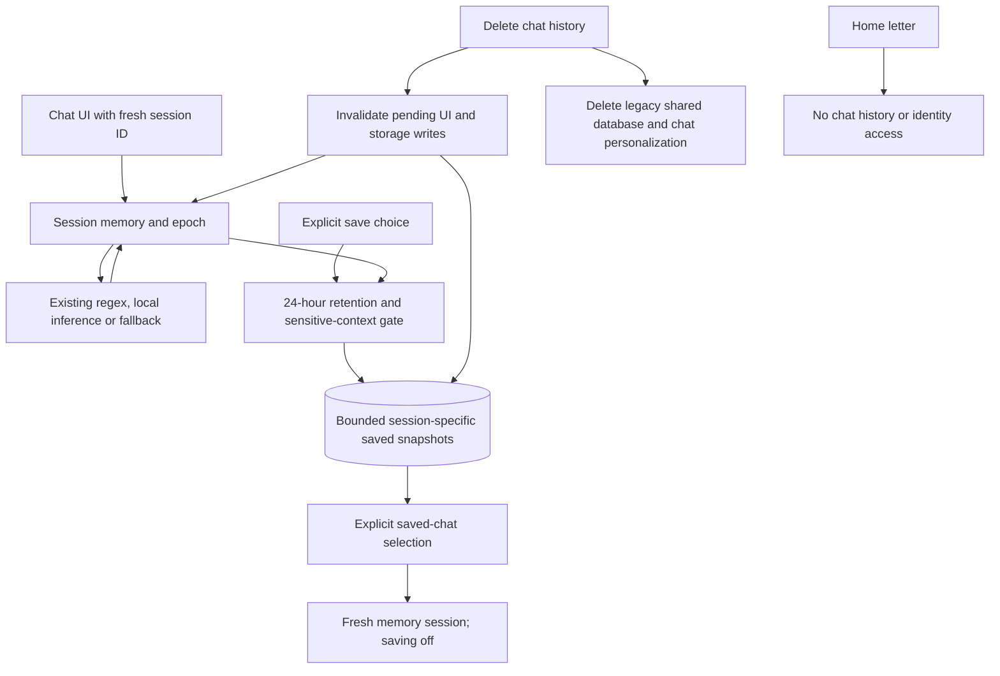

# Milestone 2 — Privacy and experiment foundation

Date: 5 November 2026. Status: implementation delivered with automated verification; final sign-off remains open for the browser and archival-data exceptions below. No Milestone 3 work, fine-tuning, learned routing, public deployment or GitHub push was performed.

## Purpose and authorship

I want Relevia’s privacy and research claims to follow from its behaviour and recorded evidence. This milestone therefore addresses storage and experimental validity before model adaptation. The implementation, test execution and initial report were completed with agent assistance; first-person project aims do not imply that I independently performed those actions. The remaining review belongs alongside the successful checks, because an automated pass cannot settle browser behaviour or historical data provenance.

## Baseline and repository ownership

Both repositories were clean before editing. The application started on main at `d6d2ec2f8ccbeb69b0b992bb24b64af52fed68ce`; the research repository started on main at `5c9c051a09b107644e7984a4609ecae64b8becef`, which includes the prior audit work. Each now has a separate `research/privacy-foundation` branch. Their histories remain independent. No commit was created during this implementation; the changes are reviewable working-tree changes.

The original 44 lint errors and 11 warnings were reproduced. Source inspection confirmed the shared UID-ignoring IndexedDB store, write-only expiry, saved crisis turns and unsupported differential-privacy wording. The prior safety probes are unchanged and their limitations are deliberately retained in regression tests. The four few-shot conversations were verified against local processed validation data. All three existing notebooks had no recorded executed model results; this milestone adds protocol notes, not fabricated notebook outputs.

## Implementation and architecture

The primary change is a storage-policy boundary between the UI/inference service and persistence. The app now creates session-specific memory stores and never reconstructs a conversation from browser storage automatically. A small disclosure provides explicit saving, deliberate reopening and chat deletion. Bounded snapshots use localStorage only after consent. The legacy IndexedDB interface is no longer the active data store; its shared database is never imported and is scheduled for deletion with blocked/error reporting.

The generated-response path continues to use the existing WebLLM architecture. No inference routing policy or model change is introduced. Default crisis messages are memory-only; any recognised sensitive context disables saving for the whole chat so subsequent contextual replies do not re-persist it. This protection depends on a deliberately unvalidated detector under opt-in saving; it does not convert the detector into a safety classifier.

Names and raw text are removed from application logs. ErrorBoundary no longer stores exception content, stacks or URLs. The unused frontend Groq mechanism is replaced with a disabled stub, preserving its original implementation in Git. Speech is disabled initially. README and UI language explain separate downloads, analytics and browser voice services rather than promising that no information ever leaves the device.

Detailed rationale, alternatives, implementation and limitations are in [privacy_design_decisions.md](privacy_design_decisions.md). This includes the deliberate choice not to add authentication, encryption with colocated keys, a cloud backend or a visual redesign.

## Scientific validity corrections

The new split function allocates development examples from official training groups. The four formerly exposed validation groups are quarantined; new prompt examples no longer come from validation. All six partitions are checked pairwise at conversation level. Official seen/unseen test files retain their exact previous SHA-256 values. Atomic JSONL replacement and same-byte parsing/hashing prevent a partially written file from being presented as a valid checked snapshot.

The minimal experiment harness requires exact model revision, prompt/data versions, seed and decoding configuration. It records manifests, hashes, response/failure records and unrated quality/safety fields. It cannot silently label base inference as adapted condition C. Its preparation mode produces no responses. Model loading is local-cache-only and no model was executed here. The template deliberately leaves the revision unset rather than inventing a value. See [experiment_01_protocol.md](experiment_01_protocol.md).

## File ownership

| Repository | Changed or added implementation files | Purpose |
|---|---|---|
| relevia | src/services/chatStorage.js; db.js | Session memory, consent, retention, restore, deletion and legacy cleanup |
| relevia | src/services/releviaBrain.js | Explicit session IDs, sensitive persistence policy, stale stream guards, content-log removal |
| relevia | src/components/ChatPrivacy.jsx; Chatbot.jsx | Privacy disclosure/controls, fresh sessions, deletion guards, speech default |
| relevia | src/services/personalLetter.js | Remove cross-context identity/history disclosure |
| relevia | src/services/groqApi.js | Disable frontend cloud/key mechanism |
| relevia | src/components/ErrorBoundary.jsx; errorBoundaryHelpers.jsx | Remove persistent diagnostic content and separate helper exports |
| relevia | tests/storage.test.js; tests/inference.test.js; package.json; eslint.config.js; .github/workflows/foundation.yml | Synthetic tests, lint scope and CI definition |
| relevia | README.md | Correct privacy and safety implementation claims |
| relevia-research | src/splits.py; data/build_dataset.py; src/common.py; scripts/check_leakage.py | Group-separated development data, quarantine, atomic output, frozen-test checks |
| relevia-research | scripts/run_experiment.py; configs/experiment_01.template.json; data/synthetic_dev.jsonl | Revision-pinned A/B harness and synthetic development fixtures |
| relevia-research | tests/test_foundation.py; scripts/security_audit.py; scripts/verify_milestone_2.py | Reusable tests and redacted evidence collection |
| relevia-research | requirements-foundation.txt; .github/workflows/foundation.yml | CPU-only dependency pin and test CI |
| relevia-research | README.md; configs/base.yaml; configs/prompts.yaml; three existing notebooks | Correct development protocol without inventing executions |
| relevia-research | docs/milestone_2_report.md; privacy_design_decisions.md; storage_test_results.md; dataset_leakage_report.md; experiment_01_protocol.md; decision_log.md | Academic explanation, actual outcomes and remaining gates |
| relevia-research | results/milestone_2/*.json | Metadata-only leakage/security/verification evidence |

Raw/processed ED files were rebuilt locally but remain ignored. The archived dataset was not modified or newly published. Application build artifacts and test logs remain ignored. There are no added provider credentials.

## Security findings

`.env` is ignored and not tracked. The redacted scanner now processes every blob reachable from local refs in both repositories, without the earlier 2 MB limit. It scans token patterns and exact long values from the local .env, then scans current compiled JavaScript and HTML. The recorded scan covered 182 application blobs and 53 research blobs, and 31 compiled files; no selected-pattern or known-local-value match was found. No actual credential exposure was established in that scope. No provider was contacted, credential tested, revoked or rotated.

This is not proof that no credential has ever escaped. Unreachable Git objects, remote refs absent locally, old hosted bundles, logs outside the repositories and other credential formats remain outside the scan. If exposure is independently confirmed, the owner should revoke and rotate through the provider immediately; deleting source alone would not suffice.

The tracked historical file archive/v1_original/empathy_42k.jsonl prevents a blanket assertion that no sensitive dialogue-like records are tracked. Its archive README attributes it to an earlier broken ED workflow with about 15,000 rows; this is provenance evidence, not a completed PII/licence review. It is excluded from the new pipeline. Do not endorse redistribution of that historical artifact until provenance, licence obligations and privacy are reviewed. No destructive history rewrite was attempted.

## Actual verification and remaining risks

The automated test suite reports 18 JavaScript tests and eight Python tests passing. Changed JavaScript lint passes with zero warnings; the full legacy lint remains at 41 errors and nine warnings. Production bundling passes with large-chunk warnings. Dataset checks show zero group overlap in all 15 partition pairs and unchanged test hashes. Machine-readable final exit codes are in results/milestone_2/verification.json; [storage_test_results.md](storage_test_results.md) records commands, failure history and interpretation.

Browser UI verification could not be completed: the browser connector timed out reaching the loopback development server. This means layout, click flow, browser back/forward caching, real legacy IndexedDB blocking and two-tab deletion have not received end-to-end confirmation. Unit tests cover the storage state machine and its failure contracts, not every browser implementation. CI files are supplied but no hosted CI run or clean-install result is claimed.

Other residual risks are explicit: local saving has no authentication or application encryption; expiry cannot physically erase data while the browser is closed; manually reopened saved chats are visible to anyone sharing the browser profile; the original detector still misses indirect/variant language; old journal/visualization/error storage is separate; analytics and voice need their own network audit. These limitations prevent universal privacy or clinical-safety claims.

## Acceptance matrix

| Criterion | Evidence/status |
|---|---|
| Default chat does not persist after session | Implemented; fresh-store/page-end tests pass; browser lifecycle confirmation pending |
| Persistence requires explicit choice | Implemented; storage tests pass; rendered interaction confirmation pending |
| Conversation isolation in tests | Pass: separate IDs and no automatic restoration |
| Retention/deletion in tests | Pass: read/write expiry, stale writes, withdrawal, blocked cleanup |
| Unsupported DP claims corrected | Pass in active app source and README; old audit accurately records former claim |
| No known frontend credential exposure | Pass within scan scope; frontend key mechanism disabled; historical external exposure unknown |
| Development/validation overlap eliminated | Pass at conversation-group level; prior exposed groups quarantined |
| Automated tests execute successfully | Pass: 18 JavaScript and eight Python tests |
| Production build succeeds | Pass in installed local environment |
| Changed files pass lint; legacy failures separate | Pass changed scope; full legacy failures recorded |
| Research diary/report explain evidence | Delivered with limits and reproduction commands |

On 5 November 2026, Bushra explicitly accepted the missing browser verification as an exception for local research work only. This records a scope-limited acceptance, not a successful browser test. Browser interaction, lifecycle, legacy IndexedDB and multi-tab checks remain required before release. The acceptance does not clear the archived dataset’s provenance or authorise its redistribution, model training, deployment or a public push.

**Final Milestone 2 sign-off remains open** because the historical-data exception is unresolved. The browser gap alone no longer blocks local research; it remains a release gate. This is not blanket permission to start Milestone 3.

Before release, complete a disposable-profile browser check using synthetic messages: default reload, opt-in/reopen, two-session isolation, expiry with a controlled test clock, and clear during generation. Record screenshots/storage observations without real conversations. Then decide how to quarantine or document the historical dataset before any new public push.

For an interview, explain why storage isolation is not authentication; why deletion requires invalidating in-flight work; why physical expiry differs from filtering reads; why four removed example rows did not eliminate conversation leakage; and why passing infrastructure tests is not model-performance evidence.
